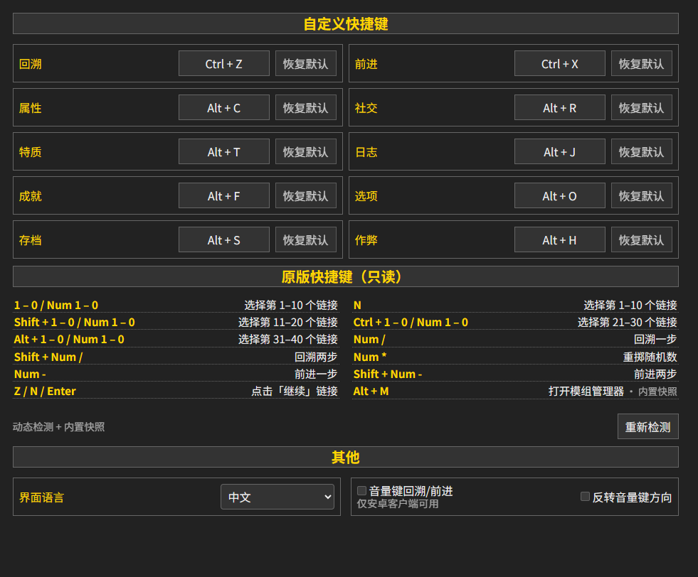

**简中** | [English](README_EN.md)

# DoL 通用快捷键

为 [Degrees of Lewdity](https://gitgud.io/Vrelnir/degrees-of-lewdity) 的常用功能提供可自由改键的快捷键

- 依赖：ModLoader >=2.1.0
- 兼容性：DoL >=0.4.2.7 （实测 `0.4.2.7` `0.5.0.5` `0.5.12.13`）

---

## 功能简介

- 设置新增「快捷键」分页以及多个可改键动作：回溯、前进、属性、社交、特质等
- 任意按键、最多 8 步的有序组合绑定，键位框即录制入口，松开按键自动保存
- `Esc` 取消修改、`Backspace` 置空禁用，配置存于 `localStorage`
- 安卓客户端可选接管音量键，默认音量 `+` 回溯、`-` 前进，可反转
- 输入框聚焦、`V.tempDisable` 期间不响应

---

## 界面预览



---

## 开发

```bash
npm install
npm run typecheck
npm run build     # dist/：hotkeys.js、hotkeys-early.js、hotkeys.css、boot.json
npm run pack      # dist/DoL-Hotkeys-<version>.mod.zip
npm run test:e2e  # 本地 HTTP + 无头浏览器 + CDP 断言
```
