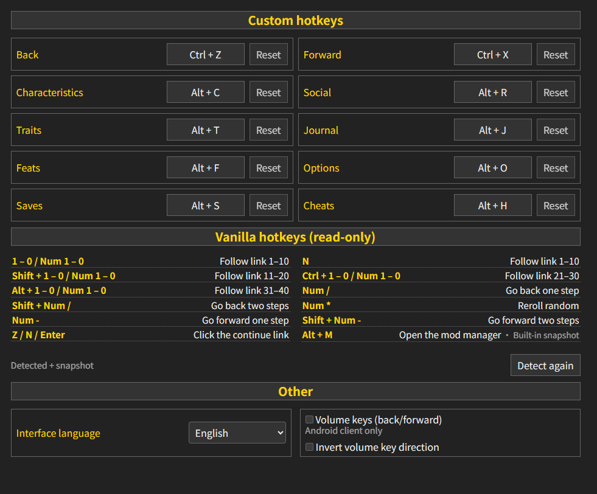

[简中](README.md) | **English**

# DoL Universal Hotkeys

A fully rebindable hotkey set for [Degrees of Lewdity](https://gitgud.io/Vrelnir/degrees-of-lewdity): back, forward, characteristics, social, traits, journal, feats, options, saves and cheats.

- Requires: ModLoader >= 2.1.0
- Compatibility: DoL >= 0.4.2.7 (tested on `0.4.2.7`, `0.5.0.5`, `0.5.12.13`)

---

## Preview



---

## Development

```bash
npm install
npm run typecheck
npm run build     # dist/: hotkeys.js, hotkeys-early.js, hotkeys.css, boot.json
npm run pack      # dist/DoL-Hotkeys-v1.0.0.mod.zip
npm run test:e2e  # local HTTP + headless browser + CDP assertions
```
